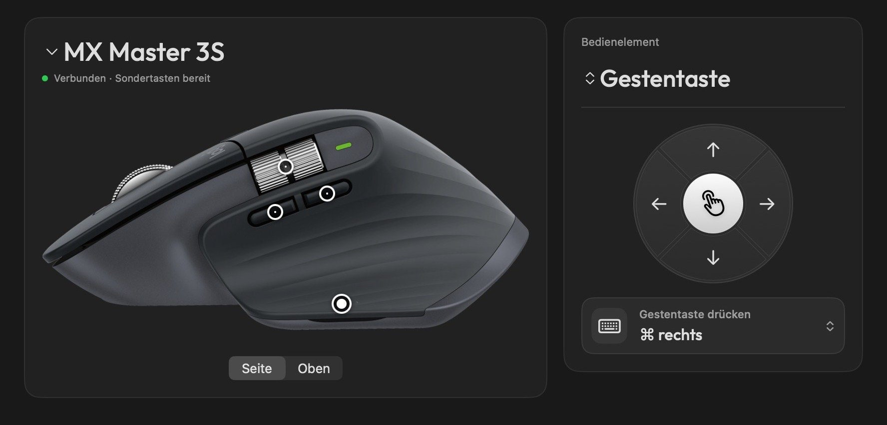
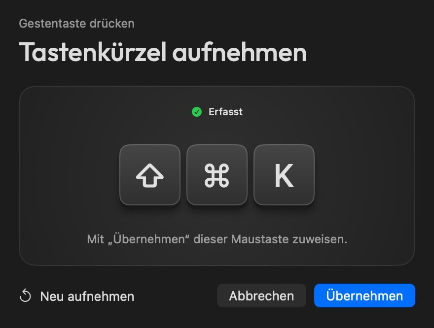

# MX Buddy

Mit dem Daumenrad zwischen Desktops und Vollbild-Apps wechseln, per Gestentaste Mission Control öffnen oder ein eigenes Tastenkürzel auslösen. MX Buddy lebt in der Menüleiste und speichert deine Belegungen pro Maus.

**macOS 14 oder neuer** · **MX Master 3S und MX Master 4 über Bluetooth** · [App herunterladen](https://github.com/kchromik/MX-Buddy/releases/latest)

## Erste Schritte

1. Das ZIP entpacken, **MX Buddy** in den Ordner **Programme** ziehen und öffnen.
2. Unter **Systemeinstellungen → Datenschutz & Sicherheit** die **Bedienungshilfen** und die **Eingabeüberwachung** für MX Buddy aktivieren.
3. In der Mausansicht auf eine Taste oder ein Rad klicken und die Aktion wählen.

Für den Desktopwechsel müssen die entsprechenden Kurzbefehle unter **Tastatur → Tastaturkurzbefehle → Mission Control** aktiv sein. Reagiert ein Bedienelement doppelt, seine Belegung in Logi Options+ deaktivieren.

## Eigene Tastenkürzel

**Eigenes Tastenkürzel** wählen, die gewünschte Taste oder Kombination drücken, loslassen und mit **Übernehmen** speichern. Auch die rechte ⌘-Taste allein lässt sich so zuweisen.

Modellbilder von Logitech · [MX Master 3S](https://www.logitech.com/en-us/shop/p/mx-master-3s) · [MX Master 4](https://www.logitech.com/en-us/shop/p/mx-master-4)
